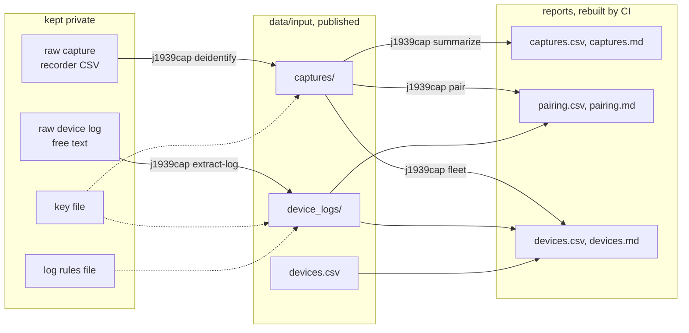

# j1939-capture-pipeline

[](https://github.com/JacobCCMorgan/j1939-capture-pipeline/actions/workflows/ci.yml)

Decode and check J1939 CAN bus captures from heavy trucks, set them next to the log of the device that recorded
them, and compare trucks and makes.

A capture is a few minutes of raw frames recorded from a truck's 9-pin diagnostic connector by the telematics
device fitted in it. The command line tool, `j1939cap`, answers what a compatibility engineer asks of one: is the
recording intact, which controllers are on the bus, which of them sends speed, engine speed, distance and engine
hours, do multi-packet messages arrive whole, does the truck broadcast its VIN. With the device's own log next to
the capture it also answers whether the device read what the capture holds.

## What 79 real captures show

The repository carries 79 captures from 75 trucks, 15,139,878 frames, and for 57 of the trucks an extract of
the device's log of the same hours. The data is real: recordings from working trucks in service, taken by the
devices of a small provider of electronic logging devices and de-identified
([data/input/SOURCE.md](data/input/SOURCE.md)). What follows describes those recordings. It is engineering
evidence about 75 trucks, of the kind a compatibility engineer works from, not statistics about a fleet.

Each statement says what kind it is: **measured** is counted in the files, **compared** sets two records
against each other, **estimated** is an inference whose method is given below. Every number in the five findings
is in [reports/](reports/), rebuilt from the published files by three commands and compared by CI on every push;
the one statement that is not from the published data says so.

1. **The recorder reports no drops in any of the 79 captures; three of them are missing 7 to 12% of their
   frames.** *Measured:* 20 captures hold rows cut at the wrong byte offset, 399 rows in 29 runs, out of which 321 frames
   can be read back. *Estimated:* those three miss 7.3%, 9.3% and 12.2% of their frames; in the other 70 where it can be
   estimated the figure is at most 1.04%, median 0.5%. The same three are the only ones where fewer than 90% of
   the multi-packet messages arrive whole (65.2%, 65.4%, 85.3%; 93.7% or more everywhere else). So the recorder is
   mostly sound, and when it is not, its own summary does not show it.
2. **Which controller sends a value depends on the make.** *Measured*, on the 69 trucks with a usable capture:

   | make | trucks | speed sent by | distance sent by | VIN on the bus | two distance sources | more than 1 km apart | with a log | device reads all five |
   |---|---|---|---|---|---|---|---|---|
   | Freightliner | 12 | 00 x12 | 00+17 x9, 00 x3 | 0 | 9 | 8 | 8 | 8 |
   | International | 8 | 00+0B x8 | 00+17 x8 | 1 | 8 | 7 | 8 | 8 |
   | Kenworth | 14 | 00 x14 | 00+31 x7, 00 x4, 00+17+27 x2, 00+27 x1 | 9 | 10 | 6 | 11 | 10 |
   | Peterbilt | 13 | 00 x13 | 00+31 x6, 00 x4, 00+17+27 x2, none x1 | 8 | 8 | 6 | 11 | 9 |
   | Volvo | 22 | 11 x21, none x1 | 17 x21, 00 x1 | 20 | 0 | 0 | 16 | 14 |

   Addresses are J1939 source addresses in hex, and `00+17 x9` means nine trucks on which both send the value. In
   the J1939 list of preferred addresses 00 is the engine, 0B the brake system controller, 11 cruise control, 17
   the instrument cluster, 27 a management computer and 31 the primary cab controller; what a manufacturer puts
   at an address can differ. The VIN is broadcast by 38 of the 69 trucks, and that too follows the make. The last
   two columns are counts of these trucks, which were chosen to include some that are hard to read (Limits);
   they are not rates for a make.
3. **Two controllers often carry two different distances.** *Measured:* 35 trucks send total distance from two or
   three controllers. On 27 of them the values are more than 1 km apart, on 22 more than 100 km, on 9 more than
   100,000 km; the largest gap is 2,223,848 km. *Estimated:* a distance divided by the engine hours of the same
   bus is the truck's average speed over its life, and the 39 trucks whose sources agree put the middle eight
   tenths of that figure between 38.5 and 74.5 km per engine hour. On the 9 trucks more than 100,000 km apart, the
   engine's own distance falls below that band on 7, and on 5 of those the other controller's falls inside it; on
   1 it is the engine's that fits and the other that does not. A distance that no longer fits the engine hours
   is what a replaced or reprogrammed controller leaves behind, though no service record confirms it for these
   trucks. The telematics device prefers the instrument cluster's or cab controller's distance to the engine's
   by design: it reports a controller other than the engine in 42 of 53 pairs, and in 10 of the other 11 the
   engine is the only sender. Asked, and not in the published data: on four of the nine the driver confirmed that the
   distance the device reports is the one on the dashboard, including the one truck where the engine's figure fits
   the engine hours better.
4. **The device's own log agrees with the capture.** *Compared*, on the 57 captures that have a log spanning them:
   the log has the capture request within 3 s of the capture's start time in 57 of 57, and counts the rows of the
   file in 57 of 57. The distance in the capture lies between the device's readings before and after it in 53 of
   53 pairs that can be checked, engine hours in 52 of 52, and the VIN is the same text in 28 of 28. The device's
   firmware and this decoder are two separate pieces of software working from what the same receiver took off
   the bus, and they get the same values. That is the best check of the decoder there is here; it is not a check
   of what reached the receiver.
5. **When a device cannot read a value, its capture of the same truck lacks it too.** *Compared:* of 57 devices with
   enough readings taken while moving, 8 could not read one or more of VIN, speed, engine speed, engine hours and
   distance. On 7 of them the capture of the same truck lacks that value too (3 of those captures are empty or
   nearly so). On the eighth a controller sends six characters where the VIN belongs. Capture and readings come
   through the same receiver, so this places the cause before the firmware's decoding; it does not say whether
   the truck sends the value. The trucks were chosen to include such cases, so 8 of 57 is a count and not a
   failure rate. It stays 8 of 57 with either threshold of the rule halved or doubled. The events of the
   same logs agree from two other sides. Counted per 100 reading cycles while driving, 5 of the 8 retry in
   practically every cycle and the 3 that read none of the five values retry in none; 6 of the 8 raise 55.9 to 99.5 error
   codes per 100 cycles. The 49 devices that read all five values retry in at most 0.7 cycles of 100 and raise at
   most 1.1 codes per 100.

The device and vehicle pseudonyms join the tables of
[telematics-data-foundation](https://github.com/JacobCCMorgan/telematics-data-foundation). All 75 devices are in its
device table. 60 trucks have a vehicle pseudonym here; for 28 it is the one the platform has on record for the
device, for 30 the platform has none, for 2 it has a different one.

## From raw files to reports



The two steps on the left need files that are not in the repository. Everything to the right of `data/input` runs
from a clone.

## Use

```
pip install -e .
j1939cap summarize data/input/captures --out reports                           # every capture side by side
j1939cap pair data/input/captures data/input/device_logs --out reports         # each capture next to its device log
j1939cap fleet data/input --out reports                                        # one row per device and per make
```

Those three commands rebuild every number in the findings above. To look at one capture:

```
j1939cap inspect data/input/captures/DEV-811a412817_20261019T170225Z.csv.gz    # as text
j1939cap inspect capture.csv --json                                            # the full report
```

A capture is a recorder CSV, plain or gzip, one frame per row: `timestamp_ms,can_id,data`. The recorder's
`<name>_summary.txt` next to it is read when present. The first `inspect` command prints:

```
capture    DEV-811a412817_20261019T170225Z.csv.gz: 94,273 frames in 181.0 s (520.7 per second), 4 sources, 86 identifiers, 0.17% proprietary
recorder   requested 180 s, complete yes, reports 0 drops
integrity  0 rows out of frame in 0 runs, 0 frames recovered; steady broadcasts missing 7.3% of their frames (median of 66 identifiers)
transport  231 announced, 197 complete (85.28%), 76 data frames without an announcement
eld        vehicle speed 0x00 wheel_based_vehicle_speed = 0.000
eld        engine speed  0x00 engine_speed = 599.125
eld        distance      0x00 total_vehicle_distance = 518,584.375; 0x00 total_vehicle_distance_hr = 518,584.435; 0x31 total_vehicle_distance_hr = 1,264,806.050  ** sources disagree by 746,221.675 km **
eld        engine hours  0x00 engine_total_hours = 28,149.950
eld        vin           not broadcast, 2 requests seen
dm1        0x00 malfunction_indicator; SPN 97 FMI 4 x1, SPN 651 FMI 7 x1
dm1        0x0B no lamp; no codes
dm1        0x31 no lamp; no codes
```

## Terms

| term | meaning here |
|---|---|
| frame | one message on the CAN bus: a 29-bit identifier and up to eight data bytes |
| parameter group | what a frame is about, encoded in its identifier; vehicle distance and engine hours are two groups |
| source address | which controller sent the frame, the last byte of the identifier; 00 is the engine |
| multi-packet message | a payload longer than eight bytes, sent as an announcement followed by numbered data frames; the VIN travels this way |
| proprietary | parameter groups whose content the manufacturer defines and does not publish |
| capture | the frames one device recorded from one truck in one go; here it was asked to run 60 to 240 seconds |
| device log extract | the readings and events taken out of the device's own text log; the log itself is not published |
| pseudonym | `DEV-` or `VIN-` followed by ten hex digits, a keyed hash of a serial number or a VIN |
| stand-in VIN | a VIN-shaped text that keeps manufacturer and model year and carries the pseudonym in the other positions |

## How it works

| module | what it does |
|---|---|
| `core/ids.py` | splits a 29-bit identifier into priority, parameter group, source and destination |
| `core/capture.py` | reads and writes the recorder's CSV and its summary file |
| `core/integrity.py` | finds runs of rows cut at the wrong byte offset, sets them aside and reads frames back out of them |
| `core/transport.py` | reassembles multi-packet messages, broadcast and addressed, and says for each whether it arrived whole |
| `core/signals.py` | a small hand-written catalog: speed, engine speed, distance, engine hours, fuel; "not available" and "error" are never scaled into numbers |
| `core/dtc.py` | lamp status and trouble codes of DM1 and DM2 |
| `core/vin.py` | VIN clean-up, check digit, manufacturer, model year |
| `core/report.py` | all of the above for one capture, as one dictionary; estimates the frames a recorder lost from the gaps in steady broadcasts; each controller's distance per engine hour |
| `summarize.py` | one row per capture, as CSV and Markdown |
| `deid/` | keyed pseudonyms and the rules that decide what leaves with a frame; reads its own output back before writing it |
| `devicelog/` | what an extract of a device log may hold (two tables, every value typed), the rules-file loader, the extractor and a strict reader |
| `pairing.py` | a capture next to the log of its device: is the log about it, does the device report what the capture holds, which distance does it take, how long does it pause and when does each step of the capture happen |
| `fleet.py` | one row per device and per make; which values a device could not read, and what its own log notes about retries and error codes; distance per engine hour against the trucks whose sources agree; the thresholds halved and doubled |

The core has no third-party dependencies.

The wording of the device's log belongs to its firmware and is not published. `devicelog/schema.py` lists the
fifteen reading columns and eleven events an extract may hold and the type of every value; where those values
stand in a log comes from a rules file kept outside the repository, next to the key. A value that does not fit
its type is dropped and counted, and the extract is read back and searched for the serial number and the VIN
before it counts as written.

## Thresholds and estimates

Nothing in the reports is labelled by hand. These are the numbers the rules use:

| threshold | value | where | why this value |
|---|---|---|---|
| usable capture | 10,000 frames | `fleet.py` | a switched-off or nearly silent bus leaves fewer in 240 seconds; 6 captures are below |
| moving | GPS speed of 20 km/h | `fleet.py` | above it the engine is certainly running, so a missing value is not explained by a parked truck |
| unreadable | missing in more than 20% of moving readings | `fleet.py` | values turn out to be read almost always or almost never |
| enough readings | 20 moving readings | `fleet.py` | ten minutes of driving at one reading every 30 seconds |
| around a capture | 30 s before to 12 min after the request | `fleet.py` | the device pauses its reading loop while it records (below) |
| sources apart | 1 km | `fleet.py` | well above the resolution of either distance group |
| sources far apart | 100,000 km | `fleet.py` | further than any difference in calibration between two counters |
| band of distance per engine hour | middle eight tenths of the trucks whose sources agree | `fleet.py` | leaves out the trucks whose own counters look reset |
| distance between readings | 0.5 km tolerance | `pairing.py` | a truck covers that in the seconds between a reading and the capture |
| engine hours between readings | 0.06 h tolerance | `pairing.py` | the resolution of the value is 0.05 h |

`reports/devices.md` recounts with each threshold halved and doubled:

| threshold | set to | what is counted | halved | as set | doubled |
|---|---|---|---|---|---|
| frames for a usable capture | 10000 | devices with a usable capture | 71 | 69 | 66 |
| share of moving readings without a value | 0.2 | devices with an unreadable value, of devices with enough readings | 8 of 57 | 8 of 57 | 8 of 57 |
| GPS speed that counts as moving, km/h | 20 | devices with an unreadable value, of devices with enough readings | 8 of 57 | 8 of 57 | 8 of 57 |

Four things are inferences and are named as such. The recorder's fifteen-byte record, on which the recovery of
out-of-frame rows rests, was worked out from the files, not from the recorder's source. The share of missing
frames is an estimate from timing: a steady broadcast with a gap of two to five periods is counted as short of one
to four frames, a longer silence as a pause the sender chose, and the capture's figure is the median over its
identifiers. That a distance which does not fit the engine hours belongs to a reset or replaced counter is the
likeliest reading, not a recorded fact, and engine hours are a counter of the engine controller too. And that the
device pauses its reading loop while it records a capture is read from the order of events in its log: the
recording ends a median 241 s after it starts, the file is uploaded by 251 s, and the first complete reading
comes at 346 s. In all, 338 to 3,305 s pass without a complete reading (median 360, 51 pairs), which is why the
readings around a capture are left out when devices are compared.

## Limits

- 75 trucks, recorded in October and November 2026. A capture was asked to run 60 to 240 seconds, and the
  73 usable ones hold 33 to 240 seconds of frames. This is evidence about cases, not statistics about a
  fleet, and it is not a measure of how the provider's devices perform in general.
- The trucks were not picked at random. They were chosen to cover five makes and to include some known to be hard
  to read: 13 of the 75 are here because the device had been reported as hard to read on that truck. 22 of
  the 75 devices are in the group that gets new firmware first, where a device goes after it has shown anomalies
  in the field. The sample leans toward difficult trucks.
- A missing frame may have been lost by the recorder or never sent; the capture alone cannot tell, and there is no
  second recorder to compare with. That the loss is about the same across a capture's identifiers points at the
  recorder.
- When two controllers disagree about distance the reports show the values and each one's distance per engine
  hour; they do not rule on which is right.
- A log extract cannot be rebuilt from a clone: the logs and the rules file are private. What backs it is the
  typed schema, the counts in its manifest, and its agreement with the captures (finding 4).
- The signal catalog holds twelve signals. The J1939 Digital Annex is licensed and is not redistributed here.
- Only the recorder's own CSV is read so far.
- In the published files 33.2% of the frames have their data bytes replaced by 0xFF, proprietary groups among
  them, so proprietary traffic can be counted but not studied.

## Status

In place: the decoding core, de-identification, the published captures and log extracts, pairing, and the device
and make comparison. Everything so far runs in plain Python on one machine, which is all this much data needs.

Not started: a batch pipeline over the same input (PySpark and Delta tables, scheduled with Airflow, the same jobs
on Databricks). The published captures will check that it is correct; anything about scale will use synthetic
captures, labelled as synthetic.

## Development

```
python -m venv .venv && source .venv/bin/activate
pip install -e ".[dev]"
ruff check src tests
pytest -q
```

`tests/` builds its frames and its device log by hand (`tests/bus.py`, `tests/unit_log.py`);
`tests/test_published_data.py` and `tests/test_published_logs.py` check the published files against their
manifests.

## License

The MIT license covers the code. The files under `data/` and `reports/` are real operational data, published so the
results here can be checked; they are not licensed for reuse or redistribution.
